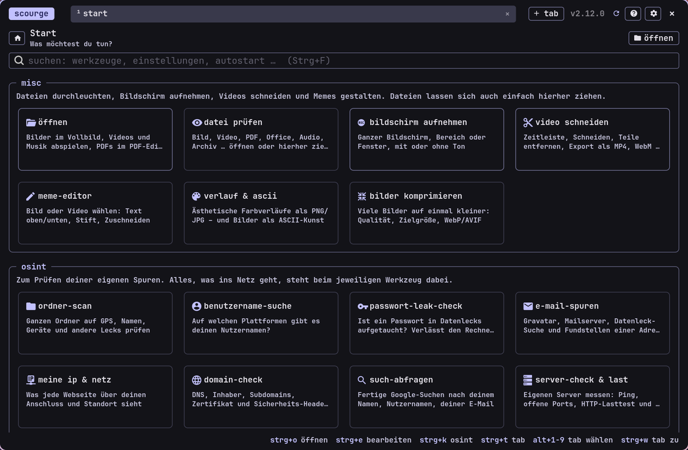

<!-- gh-header -->
<div align="center">


# scourge

**one stop for all, kinda. inspect files, edit pdfs & videos, record the screen, build memes**

   

</div>

<p align="center"></p>

<p align="center"><!-- gh-note --><sub>tip: the glass button (󰃝, top right) makes the window see-through, like the terminal – needs a compositor with blur, e.g. hyprland.</sub></p>

inspect files (metadata/exif), edit pdfs, record screen,
videos cut (edit videos), build memes, generate gradients & ascii art – a gtk4 app for linux.
it also installs and updates its sister apps (notist, filist, musicalist, datist …) from the apps bar.

## install – linux

the repository is public – no account needed. clone it with git (package `git`):

```bash
git clone https://github.com/danger-inc/scourge-public ~/scourge-src   # download once
cd ~/scourge-src
./install.sh
```

the script installs dependencies (asks beforehand, password once), copies scourge to
`~/.local/share/scourge` and creates the launcher `scourge` and a menu entry.
the icons are bundled with scourge (`app/fonts/notes-icons.ttf`). packages that don't exist on your distribution
are skipped and listed at the end.

## install – windows 10/11

1. download repo (on github **code → download zip** and extract, or `git clone …`).
2. double-click **`install-windows.bat`** in the folder.

the script sets up **msys2** once (provides gtk 4, python, poppler, gstreamer and ffmpeg for windows,
~1.5 gb, asks for admin rights), installs the font and adds scourge to the start menu.
removal: `uninstall-windows.bat`. on windows there is no screen recording and no
system settings (both linux/hyprland), and ✕ exits scourge completely.

## runs on

| system | status |
| --- | --- |
| ubuntu 24.04+, linux mint 22+, debian 13 | tested (ubuntu 24.04) |
| fedora 39+ | tested (fedora 44) |
| arch, endeavouros, cachyos, manjaro | tested (arch) |
| openSUSE Tumbleweed | should work (untested) |
| windows 10/11 | via msys2 – app start tested, installer on real windows still untested |

required is **gtk 4.12 or newer** (ubuntu 22.04 / mint 21 / debian 12 are too old – the installer says that).

## update

```bash
cd ~/scourge-src
./update.sh

```

fetches the latest version and installs it (an old version running in the background is terminated).
windows: get new version and run `install-windows.bat` again.

start afterwards:

```bash
scourge            # or via the application menu ("scourge")
scourge file.jpg   # open a file directly

```

## quick start & pdf editing

* **background mode:** ✕ or ctrl+q only hides scourge; the next call of `scourge` is instantly there
(the launcher communicates directly with the running instance via d-bus). exit completely: `scourge --quit`.
for immediate first start add to autostart, e.g. hyprland: `exec-once = scourge --daemon`.
* **pdfs** open in **scourge-pdf**, a slim pdf editor of its own (starts instantly, saves automatically, waits in the
background like scourge: `scourge-pdf --daemon`). in the toolbar: write text (font, size, color), select text &
copy, highlight, underline, strikethrough, pen, frame, note, eraser, undo (ctrl+z) and save (ctrl+s, ctrl+shift+s = new
file). pinch to zoom, click the page number to jump to a page, add your own highlight colors with "+". the annotations
are real pdf annotations and remain editable in other pdf programs. scourge itself shows only the analysis of a pdf.
  also: a side bar (F9) with page thumbnails, bookmarks and all search hits; manage pages (rotate, delete, duplicate,
drag to reorder, insert or append pdfs, extract, split); a saved signature you place with one click; fill in forms
(text, check boxes, lists); real redaction (marked areas become part of a flattened page, the text underneath is gone);
password protection; ocr for scans (needs `tesseract`). every page change can be undone with ctrl+z.
* **screen recording:** whole screen, an area or a window; sound from the system, the microphone or both mixed;
countdown, auto stop timer, an optional round webcam bubble and a highlight ring around the mouse pointer (the ring needs
`gtk4-layer-shell`; clicks cannot be detected without input permissions).
* **open:** the first tile (and ctrl+o) opens images in full screen, plays videos and music (timeline, loop, space
to play/pause) and sends pdfs to scourge-pdf. everything else goes to the file check.
* **apps bar:** mouse to the left window edge or click on "scourge" top left – starter for the other apps (see below).

## the other apps – download them from scourge

scourge is part of a small family of apps with the same look: **notist** (notes, words, latex), **filist** (files),
**musicalist** (youtube music), **datist** (calendar), **wallist** (wallpapers), **mailist** (gmail & imap),
**sharist** (quick share with your phone) and **linguist** (translator).

you don't need to clone anything for them – scourge installs them itself:

1. move the mouse to the **left window edge** (or click "scourge" top left) to open the apps bar.
2. next to every app that isn't installed there is a small **download button**. click it – scourge fetches the
   app from github and runs its installer, the button turns into a spinner and then the app can be started from the bar.
3. the row **"updates installieren"** at the bottom updates all apps at once; **"nach updates suchen"** checks github.
   every app also has its own small update button next to its version number.

the public versions of the apps are downloaded – no account needed.

if a system package needs your password (`sudo`) the button shows a warning sign – click it and the installation
continues in a terminal. old installs under former names (wallpapaer, filewise, kalender, textwise, musicminus) are
replaced and keep their data.
on **windows** the bar installs and updates **notist** and **datist** (the others are linux only); it downloads the
repo and runs `install-windows.ps1` in its own console window.

## what runs where

scourge needs **gtk 4** (linux with wayland recommended, x11 works for most things; windows via msys2).
on gnome, kde and windows the window has a normal frame, on hyprland/sway & co. it is borderless.
the app automatically adapts to an existing **matugen** theme
(`~/.cache/matugen/colors.css`); if none is there, it uses its own color scheme.

these functions depend on additional programs:

| function | needs | note |
| --- | --- | --- |
| file check, meme editor, gradient & ascii | – | runs everywhere |
| view pdf | poppler | installed via package |
| video cut / export, thumbnails | `ffmpeg` | installed via package |
| copy to clipboard | `wl-clipboard` (wayland) | under x11 gtk uses xclip-like itself |
| **screen recording** | `wf-recorder`, `slurp` | **wlroots/hyprland/sway only** – not available under gnome/kde |
| **system settings** (mouse/keyboard) | `hyprctl` | **hyprland only** – the rest (brightness/audio/radio) goes via `brightnessctl`/`wpctl`/`nmcli`, if available |

short: **file analysis, editor, cutter and studio run on every linux.**
screen recording and mouse/keyboard settings are hyprland-specific
and simply remain inactive on other environments.

## manual dependencies (if package manager is not recognized)

**python/gtk core:** gtk4, pygobject, pycairo, pillow, numpy, lxml
**gi typelibs:** gtk-4.0, gst-1.0 (gstreamer), poppler-0.18
**gstreamer plugins:** base, good, libav (for video playback)
**external tools:** ffmpeg, wl-clipboard, poppler-utils (pdftotext/pdfimages), qpdf

* **debian/ubuntu/mint:** `python3-gi python3-gi-cairo gir1.2-gtk-4.0 gir1.2-gst-plugins-base-1.0 gir1.2-poppler-0.18 gstreamer1.0-plugins-base gstreamer1.0-plugins-good gstreamer1.0-libav python3-pil python3-numpy python3-lxml ffmpeg wl-clipboard poppler-utils qpdf`
* **fedora:** `python3-gobject python3-cairo gtk4 gstreamer1-plugins-base gstreamer1-plugins-good gstreamer1-plugin-libav poppler-glib python3-pillow python3-numpy python3-lxml wl-clipboard ffmpeg-free poppler-utils qpdf`
* **openSUSE:** `python3-gobject typelib-1_0-Gtk-4_0 typelib-1_0-Poppler-0_18 typelib-1_0-Gst-1_0 gstreamer-plugins-base gstreamer-plugins-good python3-Pillow python3-numpy python3-lxml ffmpeg wl-clipboard poppler-tools qpdf`
* **arch:** `gtk4 python-gobject python-cairo gst-plugins-base gst-plugins-good poppler-glib python-pillow python-numpy python-lxml ffmpeg wl-clipboard qpdf ttf-jetbrains-mono-nerd`

## uninstall

```bash
./uninstall.sh

```

removes the app, the launcher, the menu entry and the icons. system packages and the
font remain.

## problems?

* **boxes instead of symbols:** `./update.sh` – the icon font comes along and is loaded automatically.
* **`scourge: command not found`:** `~/.local/bin` is missing in `PATH` (the installer shows what belongs in
`~/.bashrc`). from the application menu it starts anyway.
* **videos don't play:** gstreamer plugins missing (`gstreamer1.0-libav` or `gst-libav`) – `./install.sh`
again and for system packages "y".

<!-- gh-suite -->
## the -ist suite

all apps share one look (terminal style, colors from your wallpaper via matugen), one installer and the same shortcuts.

| app | what it does |
| --- | --- |
| [notist](https://github.com/danger-inc/notist-public) | notes · words · latex |
| [filist](https://github.com/danger-inc/filist-public) | file explorer + file dialog |
| [datist](https://github.com/danger-inc/datist) | calendar |
| [mailist](https://github.com/danger-inc/mailist-public) | mail |
| [musicalist](https://github.com/danger-inc/musicalist-public) | youtube music |
| [linguist](https://github.com/danger-inc/linguist) | translator + hover corner |
| [sharist](https://github.com/danger-inc/sharist) | quick share |
| [wallist](https://github.com/danger-inc/wallist) | wallpapers |
| [inquirist](https://github.com/danger-inc/inquirist) | launcher |

dotfiles with the matching hyprland setup: [danger-inc/dotfiles](https://github.com/danger-inc/dotfiles)
